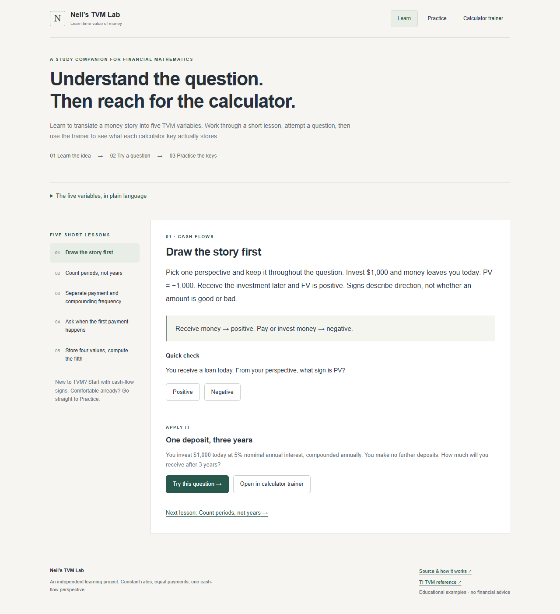
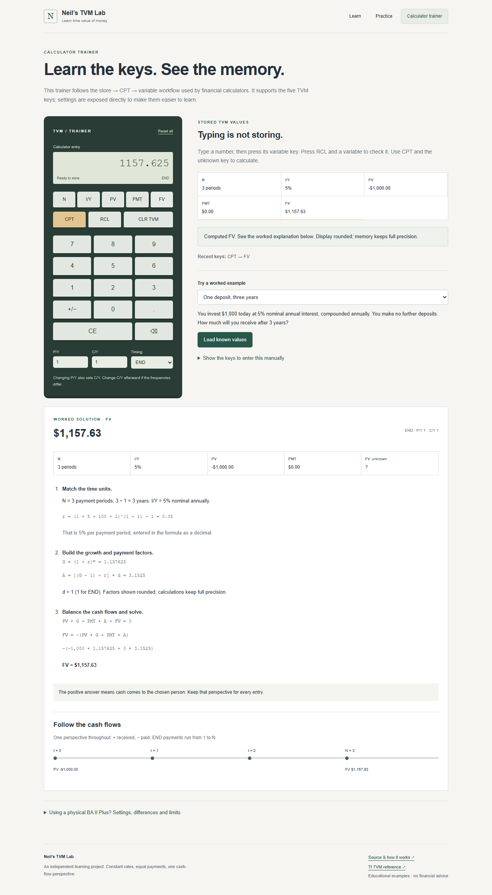

# Neil’s TVM Lab

A study companion for time value of money. Learn to translate a word problem into calculator inputs, attempt the answer yourself, and inspect the math behind it.

**[Try the live app](https://neil-314.github.io/finance-tvm-solver/)** · No account, API key or paid service required.



## Start here

1. **Learn:** five short lessons explain cash-flow signs, periods versus years, payment versus compounding frequency, END/BGN, and storing calculator values. Each lesson has a concept check and a related practice question. A glossary explains the five variables.
2. **Practice:** nine original questions cover PV, FV, PMT, N and I/Y, including loan payments, savings, annuities due, mixed frequencies and zero interest. Attempt a signed answer, ask for progressive hints, or reveal a worked solution. Feedback identifies reversed signs and, where relevant, confusion between years and periods.
3. **Calculator trainer:** enter a number, press a variable key to store it, then press CPT and the unknown key. Visible registers and a key history explain what is happening. Load a known setup to experiment, or follow the manual keystroke guide.

Practice completion is held only in memory for the current visit. Hints are allowed; revealed answers do not earn completion credit. Reloading resets progress. Calculator memory survives navigation between views, but resets when a new lesson/example is opened in the trainer or the page reloads. There are no accounts, analytics or server-side storage.

## What the calculator models

This is an **independent TVM teaching trainer**, not a complete BA II Plus emulator or a Texas Instruments product. It models the five TVM registers, store/CPT/RCL behavior, sign changes, clearing, payment timing, and frequency conversion. Settings use direct controls rather than the physical device’s secondary-key worksheets. The ordinary arithmetic keypad, amortization, uneven cash flows, bonds and other device worksheets are outside its scope.

The calculator stores full-precision results. The entry display shows up to 12 significant digits; money in summaries is rounded to cents. Re-entering a displayed result into another register stores that displayed number.



## The math

All cash flows use one perspective: money received is positive; money paid is negative. An investor’s initial investment is negative and their final receipt is positive. A borrower’s loan is positive and their repayments are negative.

| Input     | Meaning                                        |
| --------- | ---------------------------------------------- |
| PV        | Signed cash flow at time 0                     |
| FV        | Signed cash flow at time N                     |
| PMT       | Equal recurring cash flow per payment period   |
| N         | Total payment periods, **not years**           |
| I/Y       | Nominal annual rate in percent; enter 6 for 6% |
| P/Y       | Payment periods per year                       |
| C/Y       | Compounding periods per year                   |
| END / BGN | Payments at periods 1…N / 0…N−1                |

The per-payment-period rate is:

```text
r = (1 + I/Y / 100 / C/Y)^(C/Y / P/Y) − 1
G = (1 + r)^N
d = 1 for END, or 1 + r for BGN
A = ((G − 1) / r) × d, with A = N × d at r = 0

PV × G + PMT × A + FV = 0
```

PV, FV and PMT are rearrangements of that equation. N uses an algebraic logarithmic solution with an explicit zero-rate case. I/Y uses bisection on the discounted equation, which avoids overflow from very large growth factors. `log1p` and `expm1` preserve accuracy near zero interest.

Worked solutions show converted rates, growth and annuity factors, substituted values, the signed answer and a cash-flow timeline. Intermediate displays are rounded; calculations use full precision.

### Assumptions and limits

- Constant interest rates and equal payments; no fees, taxes, inflation adjustments or irregular dates.
- P/Y and C/Y are integers from 1 to 365. N is greater than zero and at most 100,000, subject to numerical range.
- N may be fractional. It represents a mathematical annuity extension; an actual whole-payment schedule needs separate rounding and a final-payment calculation.
- I/Y solving supports nominal annual rates from 0% to 10,000% and one change of cash-flow sign. Non-conventional flows may have multiple rates, so they are rejected rather than returning an arbitrary root. Negative known rates can be used for direct solves when their compounding factor stays positive; solving for a negative rate is unsupported.
- CLR TVM clears N, I/Y, PV, PMT and FV while retaining P/Y, C/Y and END/BGN. Reset all resets those settings too. Changing P/Y sets C/Y to the same value; set C/Y afterward if needed.
- CAD is a display convention, not an exchange-rate assumption. The examples are for education, not financial advice.

## Run locally

Use **Node.js 24** (also used by CI):

```sh
npm ci
npm run dev
```

Open the local URL printed by Vite, including `/finance-tvm-solver/`.

```sh
npm test                       # Math and calculator-state regression tests
npm run lint
npm run build
npx playwright install chromium
npm run test:e2e               # Browser flows and phone-width checks
npm run format                # Keep the source readable
```

The browser suite starts a local server if necessary. It also refreshes the screenshots in `docs/`. GitHub Actions runs the math tests, lint, browser checks and production build before publishing `main` to GitHub Pages.

## Read the code in this order

| File                     | Responsibility                                                     |
| ------------------------ | ------------------------------------------------------------------ |
| `src/finance.ts`         | Pure calculations, validation, root solving and numeric formatting |
| `src/learning.ts`        | Lesson text and the nine question fixtures                         |
| `src/calculatorState.ts` | Pure calculator memory and key-press transitions                   |
| `src/Explanation.tsx`    | Worked steps, register tables and timeline                         |
| `src/Calculator.tsx`     | Calculator controls, examples and physical-device guide            |
| `src/App.tsx`            | Navigation, lessons, answer feedback and practice progress         |
| `src/App.css`            | Responsive presentation; no external fonts or UI library           |

Built with React and TypeScript, served as a static Vite site. No backend or secrets are required. The math and calculator state are ordinary functions so you can test and explain them separately from the UI.

## References

Calculator conventions were checked against Texas Instruments’ own documentation. The app’s lesson wording and practice questions are original.

- [TI: TVM worksheet variables, signs, clearing and frequency conversion](https://education.ti.com/html/eguides/financials/baiiplus/en/Content/M_TVMA-WS/TVMA_Variables.HTML)
- [TI: changing END/BGN, P/Y and C/Y on a physical BA II Plus](https://education.ti.com/en/customer-support/knowledge-base/financial-calculators/product-usage/11228)

The independent tests include compound-growth reference values, a monthly loan payment, END/BGN equivalence, differing frequencies, zero and negative known rates, inverse consistency, impossible cases, overflow, register behavior and complete browser workflows.
